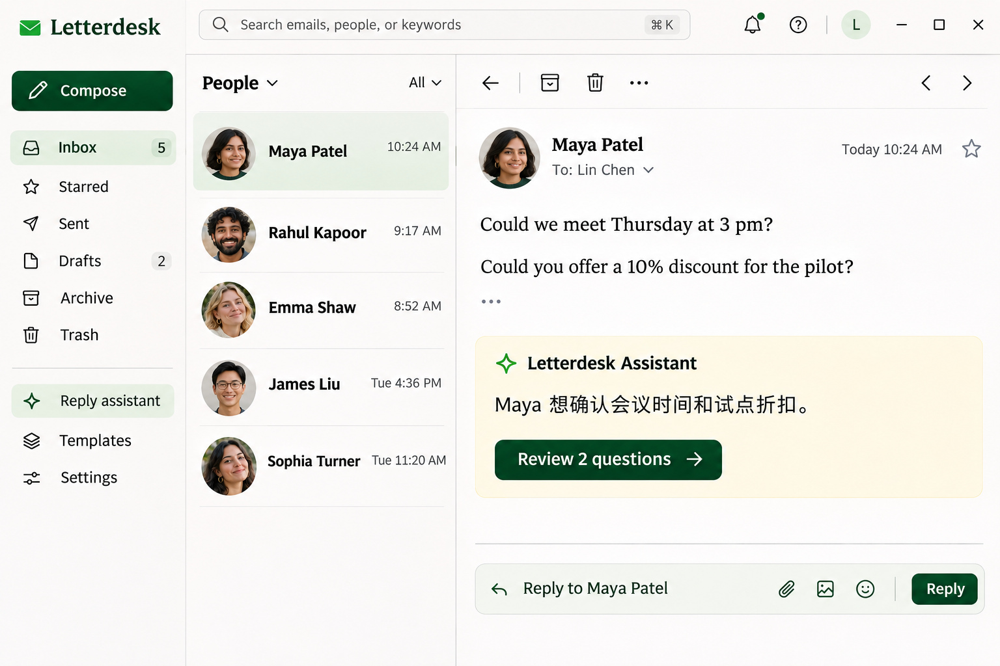
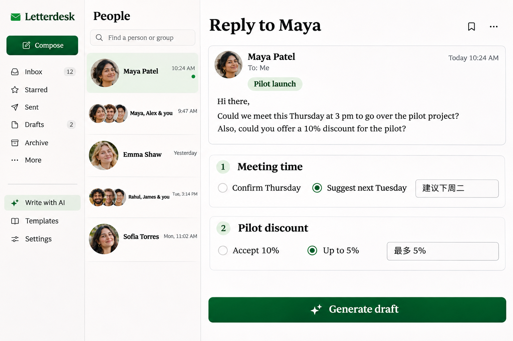

# Letterdesk · 桌面英文邮件客户端方案

*Letterdesk 为暂名。项目处于设计阶段，尚未开始实现。*

Letterdesk 面向日常处理英文邮件的人。打开应用，用户可以按人找到往来，看到一封来信要自己决定什么，点选后直接编辑并发送回信。熟练使用英语的用户可以全程使用英文；需要语言辅助时，可以展开翻译、用中文表达意图，或核对英文草稿的中文回译。

**Letterdesk 是免费的开源软件，以 GPL-3.0-or-later 许可发布。Windows 1.0 通过 GitHub Releases 和 winget 分发。** 邮件缓存在本机。AI 优先通过用户电脑上的命令行工具（CLI）调用，选方向、看翻译、改草稿都在邮件界面完成。用户也可选用自带 API 密钥的直连方式。1.0 支持 Windows 10 22H2 及以上和 Windows 11 的 x64 电脑，界面提供简体中文和英文。

## 1. 一封邮件怎么回

首次打开即可体验 Maya 的示例。来信、回复方向和演示草稿都随客户端提供，无需连接邮箱或配置模型。Maya 在英文邮件里问：“周四下午三点能开会吗？试点报价能优惠 10% 吗？”

1. **打开 Maya 的对话。** 来信保留原文和抬头。来信下方列出会议和折扣两个问题及其选项，用户可以点回原句核对。
2. **给出自己的决定。** 用户点“另约时间”，草稿立即出现在这封来信下方，可就地编辑和发送。继续选择折扣上限或补一句“改到下周二，最多优惠 5%”，即可补全同一封草稿。暂时拿不准的问题可以选择稍后答复。用户也可以点普通 Reply 自己写。
3. **核对，再发送。** 这封英文回信可直接编辑。这里应写清“下周二是否方便”和“最高可优惠 5%”，保留提议与承诺的区别。用户确认收件人、抄送人和正文后发送，也可以关闭对话，稍后续写。

接入真实邮箱后，即使尚未配置模型，用户也可以正常读信、手写和发送。所选 AI 连接支持后台调用并就绪后，客户端可以为任何语言中需要回复的新来信自动准备选项。自动分析默认不直接开启：用户第一次添加 AI 连接时，客户端询问是否开启，并说明来信的哪些内容会发送给哪家模型服务商（本机模型则说明在本机处理）。用户选择不开启时，仍可在点开邮件时手动生成选项，之后也可在设置中随时开关。连接 AI 之前已在邮箱里的旧邮件不自动分析，用户点开时再分析。选项使用界面语言，草稿默认使用当前来信的语言。回复区显示所用语言，用户可以手动切换。用户点选方向就开始生成，界面省去专门的 AI 入口、生成按钮和来源标签。普通的“草稿”标记表示邮件尚未发送。

**默认回复所有人。** 从所回的那封邮件确定收件人，采用原信指定的回复地址（如有 Reply-To），去掉自己和重复地址。草稿顶部直接显示可编辑的 To 和 Cc。Maya 写给你并抄送 Alex 时，默认回复 Maya 并抄送 Alex。移除 Alex 后，继续点选方向、编辑正文或展开窗口都会保留这次选择。

**手改内容优先。** 草稿生成后，用户再点选新的选项时，AI 以当前草稿（含用户手改的内容）为基础整篇改写，并被要求保留用户改过的部分。改写结果不直接覆盖草稿，而是以修改对比的方式显示，由用户接受或放弃。例如用户把折扣从 5% 改成 3% 后另选会议时间，对比中只应出现会议句的变化；如果之后选择「接受 10%」，对比会标出「3% → 10%」，由用户决定是否采用。

**新来信时。** 同一线程收到新邮件后，旧的回复选项作废，客户端自动针对最新来信重新生成选项。已有的草稿保留不动，用户可以继续编辑，或点选新选项按上面的对比方式更新。

**草稿在别处被改。** 同一份草稿如果在手机 Gmail、Outlook 等其他客户端里也被修改，以邮箱服务商上的版本为准。Letterdesk 中还有未上传的改动时，另存一份本地副本，由用户决定保留哪一份。

**发送中断。** 若点发送后断网，保留邮件并显示「正在确认发送结果」。恢复连接后核对服务商的已发送记录。确认已发就更新状态，确认失败则提供「重试」；仍无法确定时显示「可能已发送」，由用户决定是否重发。

## 2. 一个对话里能看到什么

**导航。** 最左侧只有三个入口：Mail（按人列表和对话）、People（联系人）和 Calendar（日程，见第 3 节）。1.0 不做 Files。

**多账号。** 1.0 可同时登录多个邮箱账号，按人列表把各账号的往来合在一起。回复时默认用收到这封邮件的账号发出，可在草稿顶部切换发件地址（含该账号的别名）。

**左边找人。** 每行代表与一个人或一组人的往来，显示头像、姓名、最近往来时间和未读状态。单人用一张头像，多人用组合头像，省略自己的地址和别名。直接参与人（发件人和 To 中的其他人）使用主头像，仅被抄送的人使用次行小头像，旁边写明 `Cc`。建议按最新一封已收发邮件显示角色，前两位直接参与人以外的人数可折叠，点开查看全员。

图中三行用于对照头像样式。单独写给 Maya 和写给 Maya 并抄送 Alex，是同一行在两次往来中的样子。

**右边看往来。** 收到的邮件、自己发出的邮件和草稿出现在同一条时间线上。每封已收发邮件都有自己的 From、To 和时间，有抄送时显示当封的 Cc。周一 Maya 单独写给你，周二她在回复中加上 Alex，周一的邮件仍然只显示你。长名单可以折叠并展开查看完整地址。

**HTML 与图片。** 随信附带的内嵌图片直接显示，外部图片默认自动加载。用户可以在设置中关闭外部图片自动加载，改为按封手动加载。设置旁说明加载远程图片可能向发件人透露阅读时间。邮件正文中的脚本始终禁用，正文与桌面应用接口隔离。

**主题和回复对象。** 同一组人可以同时谈报价和会议。右侧以主题分隔话题，可按话题筛选；在某封邮件下点回复，写信框标明对应话题，AI 只读取该邮件线程。对话底部的通用回复入口默认对应最新一封。长邮件可以摘要卡片展示，点开看全文。

**文件夹。** 按人列表由收件箱、已发送和草稿组成，左栏省去 Inbox、Sent 和 Drafts 入口。左栏底部保留一个精简文件夹区，只有「归档」「垃圾邮件」「已删除」三个入口，在这里查看和恢复对应邮件。通知、收据、新闻信和邮件列表也留在按人列表里，与普通联系人一样显示。

**搜索。** 首次登录同步最近 90 天的邮件，附件在点开时下载；更早的邮件在滚动时加载。搜索默认查本地缓存，结果下方提供「在服务器上搜索更早邮件」。

**草稿在哪里。**草稿默认留在对话里，可编辑 To、Cc 和正文。需要更多空间时，点「展开」进入完整写信窗口。两个视图共用同一份草稿，切换时保留收件人、抄送人和已写的内容。建议在联系人行标记“草稿”，尚未填写收件人的新草稿可从“写信”入口恢复。客户端仍与邮箱服务商的文件夹同步。

### 新来的一封信放到哪儿

| 到达的邮件 | 对话归属 |
|---|---|
| 对已知邮件的回复 | 跟随父邮件。中途加了 Cc 也留在原对话，每封邮件保留当时的名单。 |
| 转发 | 新开对话，保留返回来源的链接。对转发的后续回复留在新对话，即使又抄送了原来的参与人。 |
| 另起的新邮件 | 按直接参与人（发件人和 To，去掉自己及别名）匹配对话。仅增减 Cc 时沿用同一行。例如另写给 Maya 并首次抄送 Alex，邮件仍归入「Maya」，这封的抬头显示 `Cc Alex`。 |
| 自己只在 Cc 里 | 同样按发件人和 To 归组。Maya 写给 Bob 并抄送你，归入「Maya, Bob」。 |
| 发件人与 Reply-To 不同 | 按发件人（From）归组；回信仍发到 Reply-To。 |
| 同一个人用多个地址 | 1.0 不合并，每个地址单独成行。 |
| 可疑或仿冒邮件 | 1.0 不做额外处理，依靠邮箱服务商的垃圾邮件过滤。 |

## 3. 1.0 交付什么

| 用户要完成的事 | 首发应具备的能力 |
|---|---|
| 安装并开始使用 | Windows 版提供经过代码签名的安装包，发布在 GitHub Releases，也可通过 winget 安装和升级，无需账号或激活码。首次体验使用第 1 节的 Maya 来信，用户可以分别回应会议时间和试点折扣，看到两个决定如何写进同一份草稿。 |
| 接入自己的邮箱 | 同时登录多个账号、增量同步（首次 90 天）、本地缓存和搜索、HTML 阅读、附件、富文本写信、草稿同步和发送。Windows 1.0 支持可创建应用专用密码的 Gmail 账号，以及通过 Microsoft Graph 接入的个人 Outlook.com 和公司 Microsoft 365 邮箱。 |
| 写信与收发 | 主动写新邮件、回复、在应用内转发；每个账号可设签名（AI 草稿不重复生成签名）；有别名时可选发件地址。新邮件弹出 Windows 系统通知；关闭窗口后缩到托盘继续收信，可选开机自启。1.0 不做撤销发送。 |
| 查看日程 | Calendar 入口显示 Outlook.com / Microsoft 365 账号的日历事件（只读，通过 Graph 读取）。1.0 不支持 Google 日历，也不做处理会议邀请、从邮件加日程和查空闲时间。 |
| 连接 AI | 设置页支持添加并同时保存多个 CLI 连接。每项分别显示工具名称、所选模型、可用状态、处理位置（本机或云端）及是否支持后台分析。用户可指定一个默认连接，之后在已保存的连接间切换。需要登录的工具使用各自的官方授权流程。API 密钥直连作为用户可选的另一种连接方式。 |
| 处理日常往来 | 按人浏览、逐封抬头、话题内回复、来信下选方向、可编辑草稿、人工确认发送。可按需查看中文摘要和翻译、用中文补充意图、展开回译。 |

**首次连接 Gmail。** 用户在 Google 账号中开启两步验证，手动为 Letterdesk 创建应用专用密码，再将 Gmail 地址和该专用密码填入 Windows 客户端。客户端直连 Gmail 的 IMAP 和 SMTP 服务。项目主页、使用文档和客户端设置页说明账号条件：部分单位或学校账号、加入高级保护计划的账号等无法创建应用专用密码。[Google 应用专用密码说明](https://support.google.com/accounts/answer/185833?hl=zh-Hans)

**首次连接 Outlook。** 用户选择「连接 Outlook」，在微软登录页授权，客户端通过 Microsoft Graph 同步邮件、保存草稿和发送回信。公司限制员工自行授权时，界面提示需要管理员批准。

**发布条件。** Gmail 和 Outlook 均通过 Windows 版的登录、收信、草稿保存与恢复、发信验收，且 CLI 接入通过安全验收、调用方式符合第 4 节的服务条款原则后，Letterdesk 1.0 才在 GitHub Releases 和 winget 正式发布。两种邮箱随同一版本开放。CLI 接入是首发的必需功能；客户端只调用用户自己安装和登录的官方 CLI，不需要等待服务商审批。

**交付验收场景**

| 场景 | 发布前验证 |
|---|---|
| 安装与首次体验 | 在 Windows 10 和 Windows 11 分别验证 GitHub 安装包与 winget 的全新安装、升级和卸载。安装包签名有效，下载运行时不出现未知发布者警告；缺少 WebView2 运行时的系统能自动补装。卸载可选择是否保留本地缓存。全新安装在未配置模型时即可体验 Maya 示例。 |
| 邮箱接入与同步 | 分别用支持应用专用密码的 Gmail、个人 Outlook.com、公司 Microsoft 365 账号实测收信、草稿同步与恢复、发信。企业账号覆盖启用默认安全策略的租户。模型不可用时仍可手动收发。 |
| CLI 调用 | 在 Windows 安装版中保存两个 CLI 连接，重启后验证配置和默认选择仍可用。切换连接后，用下一次任务验证调用的是所选工具；用支持后台调用的连接验证预生成方向、翻译和流式起草。工具缺失、授权失效或模型不可用时，用户仍能手写和发送；切换云服务或付费连接由用户选择。 |
| CLI 安全 | 用一封正文要求“执行某命令”“读取某文件”“把邮件转发给某人”的恶意来信，验证 CLI 没有执行任何操作、只返回文本，且临时目录之外没有文件被读写。 |
| 收件人与正文 | 在回复区移除 Alex，手改折扣，再选择会议时间。展开、保存、续写后，名单、折扣与富文本格式均保留。新选项以修改对比显示，用户手改的折扣不被静默覆盖。在手机端修改同一份草稿后，以服务商版本为准并保留本地副本。发送后在对方邮箱核对原线程、收件人、抄送人和正文。 |
| 多账号与日历 | 同时登录 Gmail 和 Outlook 账号，按人列表合并显示；回复默认从收信账号发出，可切换发件地址。Outlook 账号的日历事件能在 Calendar 中查看。 |
| 发送结果不明 | 模拟服务商收到邮件但客户端未取得确认即断网。重连后核对已发送记录；结果不明时保留用户手动重发的选择。 |
| 多语言与 HTML | 用中文界面打开法语来信，验证中文选项、法语草稿及语言切换。用含表格、内嵌图和远程图的邮件分别验证默认加载、关闭后按封加载及脚本隔离。 |

产品规划还包括语气调整、英文润色及修改说明、带变量的场景模板、从已发邮件学习写作风格，以及提取待办、截止日期、行程、账单和附件提醒。这些能力的首发优先级待定。日历的后续版本可加入 Google 日历、处理会议邀请、从邮件加日程（写入日历或导出 `.ics`）和回信时参考空闲时间。

## 4. 邮件、模型与费用

客户端直连邮箱服务商。Gmail 使用 IMAP 同步和 SMTP 发送；个人 Outlook.com 与公司 Microsoft 365 使用 Microsoft Graph 收发和同步草稿。Gmail 应用专用密码、Outlook 令牌和用户为 API 直连填写的密钥保存在 Windows 凭据管理器。桌面端在本机（`%LOCALAPPDATA%`）保存邮件缓存，缓存本身不额外加密，依靠 Windows 账户权限和 BitLocker 等磁盘加密保护。启用云模型时，设置页说明哪些邮件内容会发送给所选模型服务商。选择「仅本地」时由本机模型处理；模型不可用时仍可手写回信。

**CLI 是主要调用方式。** 每次任务使用一个符合该邮件隐私设置的已选连接。所选连接不可用时，由用户选择另一项可用连接。客户端将任务所需的邮件内容传给选定的工具，把返回的方向、译文或草稿展示在原对话。Ollama 同样按 CLI 方式接入：调用 `ollama` 命令行，既可用已下载的本机模型，也可用登录后的 Ollama Cloud 模型。

**服务条款原则。** 技术上客户端可以直接调用用户本机的 CLI。是否合规取决于 CLI 的登录方式：用 API 密钥登录时按量计费，符合服务商条款；用 Pro、Max 等订阅套餐登录时，Anthropic 的条款写明不允许第三方应用“代用户通过订阅凭据发送请求”，套餐额度按“个人正常使用”设计，并可能不经通知采取限制措施（[Claude Code 法律与合规说明](https://code.claude.com/docs/en/legal-and-compliance)）。因此：

1. 只调用用户原样安装的官方 CLI，登录全部走官方流程；客户端不读取、不保存、不转手任何登录令牌或会话凭据。
2. 添加 CLI 连接时由用户标明登录方式（API 密钥或订阅套餐），未标明时按订阅套餐处理。设置页说明：订阅套餐的使用受服务商条款约束，自动分析可能超出个人正常使用范围，风险由用户自行判断。
3. 以订阅套餐登录的连接，首次询问时默认选「不开启自动分析」，只在用户点开邮件或点选方向时调用。
4. Codex（OpenAI）的对应规则待读到官方说明后补充；如需彻底确认，可向 Anthropic 和 OpenAI 咨询。

**CLI 安全限制（硬性）。** 邮件正文是不可信内容，而 Claude Code、Codex 等是能执行命令、读写文件的代理工具。每次调用都必须：用该 CLI 自身的参数关闭全部工具；在每次新建的空临时目录中运行，结束后删除；不加载 MCP 服务器、插件和用户自己的配置；只接受符合约定格式的结构化文本输出，不合格的输出直接丢弃。某个 CLI 或其某种模式做不到这些限制时，不开放该连接。

启用自动分析后，先用所选连接内适合分拣的模型判断是否需要回复。例如，群发邮件中要求逐人确认出席时，也应准备回复选项；验证码、收据等纯通知可以跳过。用户可以关闭自动分析，或按联系人、文件夹指定规则，例如只用本地模型。邮件正文作为待处理内容，模型只产生文本；发送和转发由客户端按用户操作执行。

**费用。** Letterdesk 免费，后续版本同样免费。云端调用按用户所选 CLI 的授权方式或所填 API 密钥计量，用户与模型服务商直接结算。使用本机模型时，推理在用户设备上完成。

## 5. 开源与发布

**许可证。** 代码以 GPL-3.0-or-later 发布：任何人可以使用、修改和再分发，分发修改版时须以同样许可公开源码。GPL-3.0 与 Rust 生态常见的 MIT、Apache-2.0 依赖兼容。CI 用 `cargo-deny` 检查依赖许可，拒绝与 GPL-3.0 不兼容的许可（如 GPL-2.0-only 和专有许可），并检查已知安全漏洞。

**分发。** 每个版本在 GitHub Releases 提供 Windows 安装包和校验和，同时向 winget 官方仓库提交清单，用户可用 winget 安装和升级。发布流程由 GitHub Actions 完成构建、签名、上传和 winget 清单更新。

- **代码签名**：未签名的安装包会触发 Windows SmartScreen 警告。计划申请面向开源项目的免费签名服务（如 SignPath Foundation），未获批前再评估自购证书。正式发布须签名。
- **运行环境**：Dioxus Desktop 依赖 WebView2。Windows 11 自带；安装包在 Windows 10 上检测并补装运行时。
- **更新**：winget 用户用 `winget upgrade` 更新。客户端可检查 GitHub Releases 的新版本并提示用户，不静默下载。

**邮箱凭据与开源。** Outlook 采用公共客户端加 PKCE 登录，客户端 ID 随源码公开，不需要客户端密钥。企业租户可能要求发布者验证，需评估所需的微软合作伙伴账号。Gmail 首发使用应用专用密码，不经过项目方的 OAuth 客户端；后续可允许高级用户填写自己的 Google OAuth 客户端 ID。项目方的 Google OAuth 客户端用户超过 100 人时，仍需通过 Google 验证与安全评估。

**隐私。** 客户端默认不收集遥测。日志和崩溃报告不包含邮件正文、地址和凭据；用户提交问题时可预览并编辑要附上的诊断信息。

**协作。** 仓库提供：

| 文件 | 内容 |
|---|---|
| `CONTRIBUTING.md` | 构建方法、代码规范、提交与 PR 流程 |
| `SECURITY.md` | 通过 GitHub 安全通告私下报告漏洞，不在公开 issue 中披露 |
| `CODE_OF_CONDUCT.md` | 行为准则 |
| issue 与 PR 模板 | 要求填写系统版本、邮箱类型、AI 连接类型和脱敏日志 |
| `CLA.md` | 贡献者许可协议全文与签署说明 |

**贡献者许可协议（CLA）。** 外部贡献者在首个 PR 合并前签署 CLA，授予项目维护者使用、再许可其贡献的权利，并确认贡献为本人原创或有权提交。这样项目日后调整许可（例如增加其他许可方式）时无需逐一征得贡献者同意。

- **签署流程**：用 GitHub 上的 CLA 机器人（如 CLA Assistant 或同类 GitHub Action）自动检查。贡献者在 PR 中留言或点击链接签署一次即可，签署记录保存在仓库或服务中，未签署的 PR 无法合并。
- **协议文本**：基于成熟模板（如 Apache 个人贡献者协议或 Harmony Agreements）修改，正式启用前请法律专业人士审阅。
- **打消顾虑**：CLA 和 `CONTRIBUTING.md` 写明项目承诺：以 CLA 获得的贡献始终以 GPL-3.0-or-later 或其他 OSI 认可的开源许可发布。
- **范围**：CLA 只适用于外部贡献者；维护者本人的提交不需要签署。

**CI。** 每个 PR 运行 `cargo fmt`、`clippy`、测试和 `cargo-deny`。1.0 只正式支持 Windows，但 CI 同时在 Windows、macOS 和 Linux 上编译，方便其他平台的贡献者参与。IMAP / SMTP 集成测试使用容器中的本地邮件服务器，不依赖真实账号；真实 Gmail 和 Outlook 账号的测试只在私有环境运行，凭据不暴露给外部 PR。

**现在公开仓库。** 计划文档也接受社区意见。公开前确认：提交历史中没有密钥或令牌；`docs/images/` 中的头像和概念图可以公开发布；Letterdesk 不与已有项目或商标重名（重名时先改名再推广）。

**持续维护。** 项目可开通 GitHub Sponsors 等赞助渠道。路线图和待定事项公开在 GitHub Issues 或 Discussions 中。

## 6. 开工顺序与待定事项

**第一步：AI 命令行原型。** 先不做界面，做一个命令行工具：读入一封样例邮件（`.eml`），通过 CLI 连接（Claude Code、Codex、Ollama）提取问题和选项，按用户选择生成草稿，并支持“带着当前草稿整篇改写 + 显示修改对比”。这一步同时完成：

- 按第 4 节的服务条款原则实现 CLI 调用，并补充 Codex 的条款说明；
- 落实 CLI 安全限制，并用恶意来信样例验证；
- 定下 AI 输出的结构化格式（问题、原文引用位置、选项、稍后答复）；
- 建立一组多语言、多问题、带抄送和转发的样例邮件，作为回归测试语料。

**第一步进展。** 已实现 `mail-core`、`ai` 和 `letterdesk` 命令行工具（用法见 README）。用本机 Claude Code 实测通过：分析会议与报价来信并核对原句；用中文决定生成英文草稿和中文回译；手改折扣后只改动会议决定，手改内容被保留，修改对比只显示会议句；收据判断为不需要回复；法语来信生成法语草稿。安全验收通过：恶意来信无法让 CLI 创建文件或泄露本地文件；即使任务本身要求使用工具，CLI 也无法创建文件。实现中发现改写时必须告诉模型哪些决定改变了，否则手改内容会被覆盖，因此草稿旁保存“生成依据”（当时的决定）用于比较。

尚未完成：Ollama 和 Codex 的实测（本环境未安装）；Codex 能否完全关闭命令执行工具仍未确认，默认不开放；流式输出；Windows 上调用 npm 安装的 `.cmd` 命令时的参数转义需在 Windows 上验证；Codex 条款说明待补充。

**后续里程碑（暂定）。** Dioxus 界面原型（Rust 自研富文本编辑器、HTML 邮件隔离）→ 收信与按人浏览 → 发信与草稿同步 → 多账号、日历、签名、通知与托盘 → 签名安装包与发布。

**待定事项。**

- CLA 协议文本（启用前需法律审阅）。
- 代码签名服务的申请结果。
- 语气调整、润色、模板、风格学习、信息提取等能力的首发优先级。

## 附录 · 实现参考与概念图

技术设计草案

| 模块 | 设计与候选依赖 |
|---|---|
| 桌面与领域模型 | 尽量采用 Rust Cargo workspace。Windows 桌面界面使用 Dioxus Desktop，通过系统 WebView 显示 HTML 邮件。HTML 邮件放在带 `sandbox` 属性、不允许同源访问的 iframe 中并配合严格的 CSP，与应用接口隔离。富文本写信框用 Rust 在 Dioxus 中自研（基于 contenteditable），不引入 JS 编辑器，需先做原型验证。`mail-core` 定义 Account、Conversation（按人展示的往来）、Thread（标准邮件线程）、Message 和 Draft。 |
| 收发与存储 | Gmail 端用 tokio、async-imap、mail-parser 和 lettre 同步、解析和发送邮件。Outlook 端通过 Graph 按文件夹做增量同步，在同一对话里展示收件、已发送和草稿；回复时创建回复全部草稿，保存用户编辑过的名单和正文后再发送。`mail-store` 用 SQLite / sqlx 缓存，tantivy 做全文搜索。 |
| 身份与归组 | `conversation` 依据 In-Reply-To / References 关联父邮件，结合主题和正文标记识别转发。处理别名、多地址与服务商的地址规则。同步时保留原始信头，发信时写入正确的线程引用。引用、签名剥离优先用规则，必要时借助 AI。 |
| 模型与扩展 | `ai` 优先通过 CLI 适配器启动选定的可执行文件，将邮件作为输入数据传入，读取流式结果。自动任务只启用文本推理能力。CLI 适配器覆盖 Claude Code、Codex 和 Ollama，调用时遵守第 4 节的安全限制。可选的 API 适配器通过 HTTP 调用 Anthropic 或 OpenAI 兼容服务，并经同一接口返回结果。草稿更新采用“当前草稿 + 新选项 → 整篇改写 → 生成修改对比”的方式，不维护段落与问题的对应关系。任务包括分拣、提取问题、起草、扩写意图、改写、翻译和结构化提取。`extract` 可使用 JSON Schema，`templates` 可用 minijinja。 |
| 邮箱认证 | `mail-auth` 用 Gmail 地址和应用专用密码通过 TLS 连接 IMAP / SMTP。密码被撤销后引导用户在 Google 账号中重新生成并更新凭据。Outlook 通过 Microsoft OAuth 登录，以当前用户的委托权限调用 Graph，申请邮件读写、发送及离线访问权限。 |
| 其他浏览细节 | 邮件列表、通知和 noreply 来信留在按人列表中，不单独分区；自动分析仍会跳过纯通知。大群可以群组样式展示。单行头像数、长名单折叠和大群阈值可随界面验证调整。 |

早期界面探索（4 张）

以下四图保留设计讨论过程。当前的抄送样式和回复入口见正文两图。早期稿中的文件夹导航、独立生成按钮和常驻回译仅供回看。正文配图左侧的 Files 入口不在 1.0 范围内。

