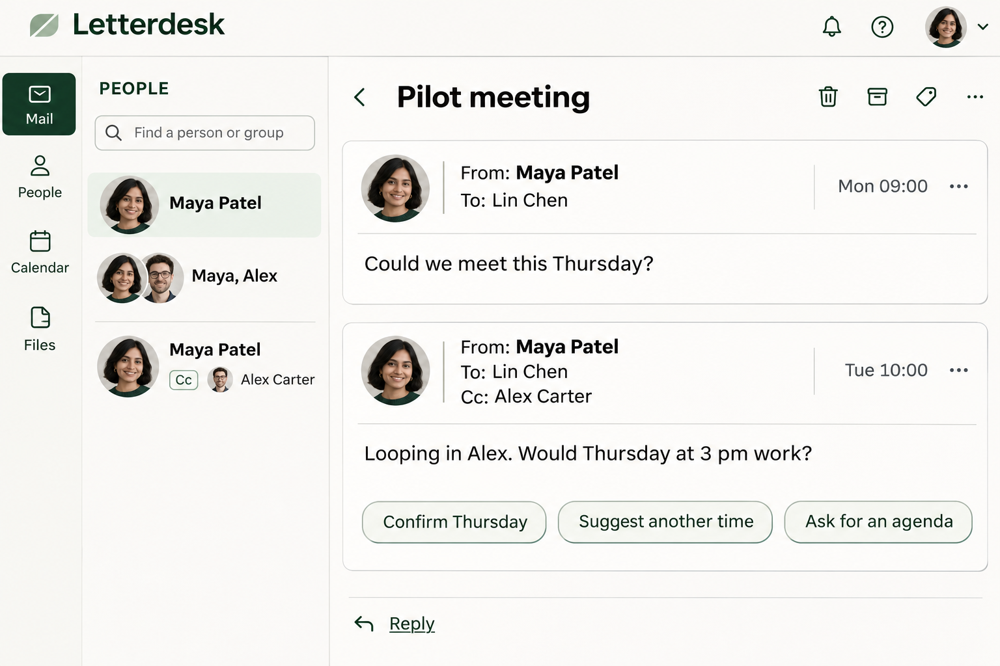
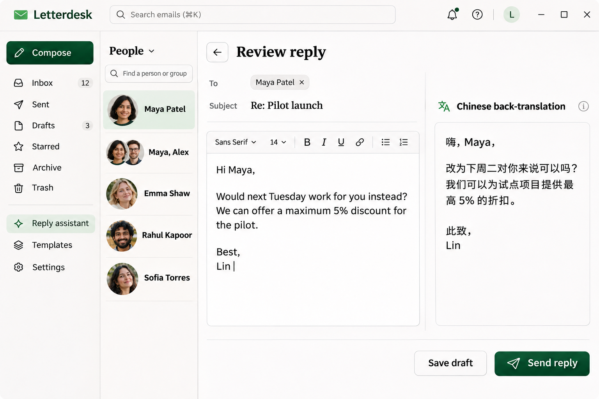
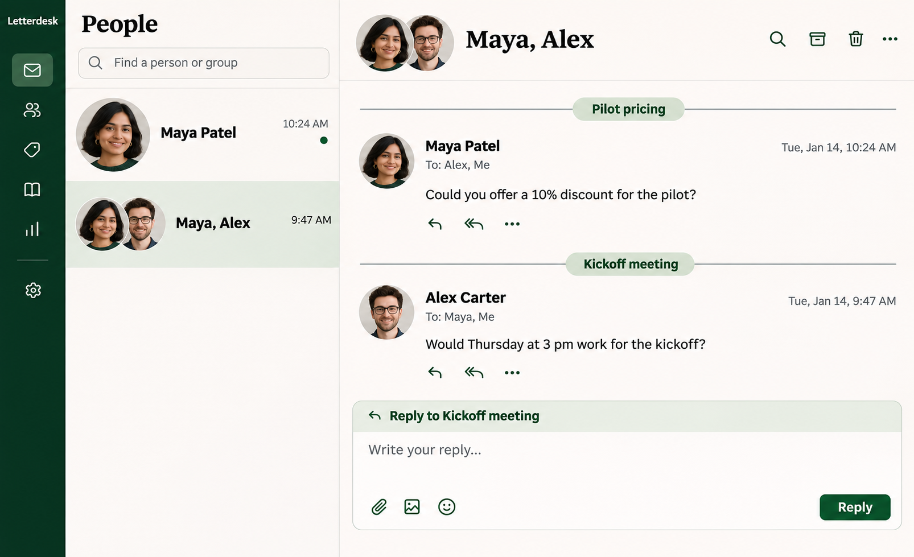
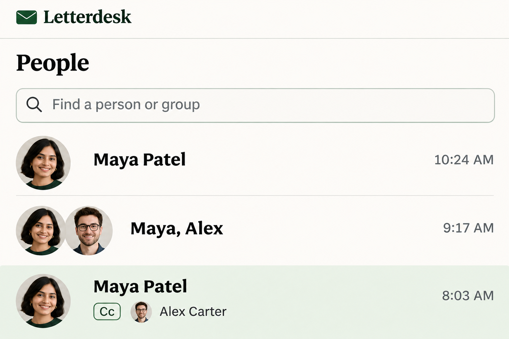

# AI 邮件客户端 · 产品与技术计划（草案）

> 状态：**计划 / 讨论阶段**，尚未开始实现。本文记录目前的 brainstorm 结论和待定问题，后续讨论会持续更新。

## 1. 一句话定位

一个用 **Rust** 写的跨平台桌面英文邮件客户端。面向所有处理英文邮件的人，包括熟练使用英语的用户。打开来信即可选择回复方向，得到可编辑的草稿。翻译、中文意图输入和回译按需使用。

### 要解决的痛点

- 商务邮件常有多个问题，需要逐项判断、避免遗漏，并核对日期、金额和承诺。部分用户还希望用中文理解来信、表达意图。
- 现有邮件客户端的 AI 支持弱，或者价格很贵（如 Superhuman 约 $30/月）。
- 传统邮件按"主题"组织，和人沟通的上下文被拆得很散。

## 2. 已确定的方向

| 维度 | 决定 |
|---|---|
| 邮箱支持 | Gmail、Outlook / Microsoft 365、自建 IMAP |
| 协议底座 | 统一用 **IMAP + SMTP**；Gmail / Outlook 走 OAuth2（XOAUTH2），自建邮箱走密码 / 应用专用密码 |
| 界面形态 | **桌面 GUI**（要给普通用户用，且必须能渲染 HTML 邮件），不做终端 TUI |
| 开发语言 | 尽量纯 Rust（前后端） |
| AI | 云端模型为主，支持多家：Anthropic（Claude）、OpenAI 兼容接口、Ollama（本地 + Ollama Cloud） |
| 交互理念 | "自动"：收到邮件 → 自动分析 → 来信下展示回复方向 → 点选即生成草稿 → 人确认 |
| 浏览方式 | **对话式**：按参与人归组成对话流，而不是按主题 |
| 商业策略 | 低价获客，**一次性买断**；本地优先、无服务器，降低边际成本 |
| 用户 | 面向公众，不只是自用 |

## 3. 核心功能

### 3.1 "自动" 回信流程

```
新邮件到达
  → ① 分拣（便宜小模型）：需要回复？通知 / 营销 / 真人来信？
  → ② 需要回复的：后台预先分析，提取"决策点"
  → 打开对话时，来信下方已显示可选方向，无需先点 Reply
  → ③ 用户点选方向 / 用中文补一句话
  → ④ 点选方向后即在原对话中流式生成可编辑的英文草稿，可按需展开中文回译
  → ⑤ 用户确认 → 发送 / 存为草稿
```

**问"决策点"，而不是泛泛地问语气。** 示例：

> 对方问了 2 件事：
> 1. 周四下午 3 点开会可以吗？ `[可以]` `[不行，改时间]` `[待定]`
> 2. 报价能否降 10%？ `[接受]` `[最多 5%]` `[不降]`
>
> 还有要补充的吗？（中文即可）`______`
>
> 语气：`正式` · `友好` · `简短`

点两下就能得到一封逐条回应、语气得体的英文回信。

**原则：AI 永远不自动发送**，只生成草稿，人确认后才发出。

**默认交互（产品暂名 Letterdesk）**。AI 在后台准备回复方向。每封待回复的来信下直接显示与内容有关的选项，例如“确认周四”“另约时间”“询问议程”。点选即产生草稿，用户可继续选择其他问题的答案、补充说明或直接编辑。常规 Reply 仍可手动写信。界面无需单独的 AI 开关按钮、生成按钮或草稿来源标记；自动分析的隐私偏好见 4.4。



以下三图按先前讨论稿重绘，记录读信、表态和核对草稿三个状态。首发交互以上图及本节文字为准：方向选项直接出现在来信下，翻译和回译按需展开。

1. **读信。** Maya 询问周四下午三点能否开会，以及试点报价能否优惠 10%。中文摘要保留时间、数值和提议方；用户可以从每个问题跳回原文。


2. **表态。** 用户可以逐项选择，也可以直接写“改下周二，折扣最多 5%”。界面把这句话对应到两个问题上，允许将暂时拿不准的一项标为“稍后答复”。


3. **核对并发送。** 编辑英文草稿，需要时在右侧展开中文回译。建议对应标出日期、金额和承诺措辞，例如保留“最多 5%”中的上限。用户可保存草稿或确认发送。



### 3.2 英文邮件副驾驶

1. **对照阅读**：英文来信旁显示中文翻译 + 三行摘要。
2. **中文意图 → 英文邮件**：输入"周四不行，改下周二，合同我会提前发"，输出地道英文邮件。
3. **一键改语气**：更正式 / 更随意 / 更委婉 / 更坚定 / 更简短。
4. **中文回译核对**：生成的英文下附一行中文回译，不用逐字读英文就能确认意思没偏。
5. **润色自己写的英文**：保留原意，只修语法和措辞，并标出改了什么、为什么。
6. **常用场景模板**：催款、跟进、婉拒、约会议、致歉……支持变量和 AI 填空槽（如 `{{客户名}}`、`{{ai: 根据上一封写一句寒暄}}`）。
7. **风格记忆**：从已发邮件中学习用户的称呼、签名、写信习惯（检索相似邮件做 few-shot）。

### 3.3 从邮件中提取结构化信息

用结构化输出（JSON schema）提取：

- **日程** → 加入 Google Calendar / Outlook Calendar，或生成通用 `.ics`（Google Calendar 权限不是"受限"级别，审核比 Gmail 简单）
- **待办与截止日期**
- **航班 / 酒店 / 快递单号** → 行程卡片
- **账单与金额**
- **附件处理提醒**（如需要签字的合同）

日历集成计划放在后期版本。

### 3.4 对话式浏览

参考产品：Spike（聊天式邮件）、Delta Chat（基于邮件协议的聊天应用）。

**两层数据模型：**

```
Conversation（对话流，视图层，按参与人归组）
  └── Thread（话题，标准邮件线程，依据 References / In-Reply-To）
        └── Message（单封邮件）
```

**左栏按人找往来。** 主导航只列联系人和群组，收信、发信和草稿统一显示在对应的对话中，左栏省去 Inbox、Sent 和 Drafts 三个文件夹入口。 一行代表一个对话流。单人显示头像和姓名，多人显示对方的组合头像和姓名，省略当前用户自己的账号与别名。建议最多露出两位直接参与人的头像，其余以人数表示，点开可查看完整名单。时间和未读标记留在行尾。主题放在右侧时间线作为话题分隔条；回复框标明正在回复的话题，AI 取该线程作上下文。



**右侧每封邮件保留独立抬头。** 按时间穿插收到的邮件、自己发出的邮件和当前草稿。每封已收、已发邮件都显示该封的 From、To、时间以及实际存在的 Cc；长名单折叠时保留人数，可展开查看地址。例如周一 Maya 写给 Lin，周二在同一线程抄送 Alex，只有周二的邮件显示 `Cc Alex`。左栏头像随最新往来更新，历史邮件使用原始信头。

**对话内的草稿。** 草稿显示“草稿”状态及可编辑的收件人、抄送人和正文，用户确认后才发送。建议有草稿的联系人行显示简短标记，重新打开时可续写；主动新建、尚未填写收件人的草稿可从写信入口恢复。底层仍与服务商的收件、已发和草稿文件夹同步。

**直接参与人与 Cc 分层显示。** 建议左栏根据该流最新一封邮件的信头绘制头像。发件人和 To 中除自己以外的人使用主头像；仅出现在 Cc 中的人使用次行小头像，旁边标注 `Cc` 和姓名。例如，同时写给 Maya 和 Alex 时，两人头像并列；写给 Maya 并抄送 Alex 时，Maya 占主行，Alex 出现在 Cc 行。临时增加抄送人沿用原对话流；展开历史邮件时，各封仍显示各自的 From、To、Cc。



**归属规则（初稿）：**

1. **是回复**（In-Reply-To 指向已知邮件）**且不是转发** → 跟随父邮件进入同一对话流；中途 CC 新的人也不拆分，对话流成员只增不减。
2. **是转发**（主题含 `Fwd:` / `FW:` / `转发:`，或正文有转发标记）→ **一律新开对话流**，保留"来自某对话"的链接。之后在这封转发邮件上的回复都留在新流里，即使又 CC 回了原来对话里的人（例如 A 把 B 的邮件转发给 C，C 回复时 CC 了 B，仍属于新流）。
3. **是新邮件**（非回复）→ 按核心参与人集合（发件人 + 收件人 + CC，去掉自己）查找已有对话流；完全匹配则并入，否则新建。

**需要处理的问题：**

- **身份合并**：同一个人多个地址；用户自己多个账号 / 别名；大小写与 `+tag` 归一化。
- **同一流内话题混杂**：用主题分隔条 / 话题标签区分，支持按话题筛选。
- **AI 上下文按 Thread 取，不按整个 Conversation 取**，避免话题串味和浪费 token。
- **在流里回复时回哪一封**：默认最新一封，并正确设置 In-Reply-To / References，让对方在 Outlook / Gmail 中看到的仍是正常线程。对话视图只是本地展示方式，协议层完全标准。
- **去除引用和签名**（"On … wrote:"、签名、免责声明）：对话视图的体验核心和技术难点，先用规则处理，AI 兜底。
- **长篇正式邮件**：不塞进气泡，显示为卡片（一行 AI 摘要，点开看全文）。
- **非对话邮件**：邮件列表、通知、`noreply` 地址进入单独的"信息流 / 通知"区。
- **大群邮件**（如超过 8 人）：用类似群聊 / 频道的样式。

## 4. 技术方案

### 4.1 GUI 框架选型

硬需求：**渲染 HTML 邮件** + **富文本写信框**。

| 框架 | 渲染方式 | HTML 邮件 | 富文本编辑 | 备注 |
|---|---|---|---|---|
| **Dioxus** | 系统 WebView，写法类似 React | ✅ 天然支持 | 可做（contenteditable） | **首选**：全 Rust 代码，保留 Web 渲染能力 |
| **Tauri + Leptos** | WebView + WASM 前端 | ✅ | 同上 | **备选**：打包、自动更新、插件生态更完善 |
| GPUI（Zed） | GPU 自绘 | ❌ 需嵌入 WebView | 强 | 性能和质感最好，但 HTML 邮件是硬伤 |
| iced | GPU 自绘 | ❌ | 弱 | COSMIC 桌面在用 |
| Slint | 自绘 | ❌ | 弱 | 偏嵌入式，注意授权条款 |
| egui | 即时模式 | ❌ | 弱 | 适合工具类，不适合消费级产品 |

对话流界面（气泡 + 卡片）用 HTML/CSS 实现最自然，这也是选 WebView 类方案的理由。

### 4.2 Cargo workspace 结构（草图）

```
email-client/
├── crates/
│   ├── mail-core/     # 领域模型：Account, Message, Thread, Conversation, Draft
│   ├── mail-sync/     # IMAP 同步 (async-imap)，IDLE 推送，增量同步
│   ├── mail-store/    # SQLite (sqlx) + 全文搜索 (tantivy)
│   ├── mail-send/     # SMTP 发信 (lettre)
│   ├── mail-auth/     # OAuth2 (Gmail / Outlook)，密钥存储 (keyring)
│   ├── conversation/  # 按参与人归组、身份合并、引用 / 签名剥离
│   ├── ai/            # 统一的 AI 接口 (trait)、多家适配器、流式输出
│   ├── extract/       # 结构化提取：日程、待办、行程、账单
│   ├── templates/     # minijinja 模板 + AI 填空槽
│   └── app/           # Dioxus 桌面应用
```

**主要依赖：** `tokio`、`async-imap`、`mail-parser`、`lettre`、`sqlx`、`tantivy`、`reqwest` + SSE 解析、`oauth2`、`keyring`、`minijinja`、`dioxus`。

### 4.3 AI 层

```rust
pub enum ProviderKind {
    Anthropic,        // Claude Messages API
    OpenAiCompatible, // OpenAI / DeepSeek / OpenRouter / 通义 / Kimi …（填 base_url）
    Ollama,           // 本地 localhost:11434 或 Ollama Cloud（同一协议 + API key）
}

#[async_trait]
pub trait LlmProvider: Send + Sync {
    async fn complete_stream(
        &self,
        req: CompletionRequest,
    ) -> Result<BoxStream<'static, Result<String>>>;
}

pub enum Task {
    Triage        { message: Message },
    DecisionPoints{ thread: Thread },
    DraftReply    { thread: Thread, choices: Vec<Choice>, note: Option<String>, tone: Tone },
    ExpandIntent  { thread: Option<Thread>, intent_zh: String },
    Rewrite       { text: String, instruction: String },
    Translate     { text: String, target: Lang },
    Extract       { message: Message },
}
```

- **用户自带 API key（BYOK）**：存于系统钥匙串，不经过我们的服务器。
- **按任务选模型**：分拣、提取用便宜快速的模型；正文生成用更强的模型。
- **一律流式输出**。

### 4.4 隐私与安全

- 本地优先：邮件数据只存在用户电脑上。
- 自动分析可以关闭，并可按联系人 / 文件夹设置规则；敏感对象可指定只用本地模型。
- **提示注入防护**：邮件正文是不可信内容，AI 只输出文本，不给它发信 / 转发等工具权限。
- OAuth token、API key 存系统钥匙串。

## 5. 认证与平台审核

| 服务商 | 方式 | 注意事项 |
|---|---|---|
| Gmail | OAuth2 XOAUTH2，scope `https://mail.google.com/` | 属于**受限 scope**：未验证应用最多 100 个测试用户；公开发布需 Google 验证 + **CASA 安全评估（每年一次，有成本）** |
| Outlook / M365 | Azure 应用注册，`IMAP.AccessAsUser.All`、`SMTP.Send`、`offline_access` | 已禁用普通密码登录；部分企业租户需要管理员同意 |
| 自建 IMAP | 用户名 + 密码 / 应用专用密码 | 最简单 |

**Gmail 早期策略：** 测试用户名额 + 应用专用密码（需开两步验证）+ 允许高级用户填自己的 OAuth Client ID；用户量起来后再做 CASA。

## 6. 商业模式

**已确定：一次性买断**，不做订阅。

- **买断 + 用户自带 key**：软件本身一次付费；AI 费用由用户直接付给模型服务商（用 Ollama Cloud、DeepSeek 等便宜模型，每月可能只有几块钱）。我们没有持续的 AI 成本，这是买断模式能成立的前提。
- **本地优先、无服务器**：没有存储和带宽成本，卖出一份几乎没有边际成本。
- 价格目标：远低于同类产品一年的订阅费（如 Superhuman 约 $30/月）。
- **成本控制**（帮用户省自己的 key 费用）：只对真人来信做自动分析，跳过通知 / 营销 / 群发；分拣用小模型。

**买断模式下要考虑的问题：**

- **持续成本 vs 一次性收入**：Gmail CASA 安全评估每年一次、代码签名证书、Azure 应用等都是年费，需要靠持续的新用户覆盖 → 早期可先主推 Outlook + 自建 IMAP。
- **托管 AI 额度不适合包含在买断里**（会变成无上限的持续成本）。如果以后要照顾不想配置 key 的用户，可以做成**可选的预付费额度包**，用多少买多少。
- **大版本升级策略**：买断包含哪些更新？常见做法：
  - 永久免费更新（最简单，最吸引人，但长期收入只靠新用户）；
  - 买断当前大版本，下一个大版本付费升级（老用户优惠）；
  - 买断永久可用 + 一年免费更新，之后续费才能继续获得更新（类似 Sketch / JetBrains 的回退授权）。
- **授权与防盗版**：本地离线校验许可证（如签名的 license key），不能因为没有服务器就做不了激活；也不要做得太重伤害正版用户。
- **销售渠道**：自有网站 + 支付平台（如 Paddle、Lemon Squeezy 这类代收税务的商户平台），或者 Mac App Store / Microsoft Store（抽成更高，但获客更容易）。

## 7. 商品化 1.0 首发范围

首个对外版本直接交付可购买、可安装、可日常收发邮件的桌面应用。以一封商务来信验收完整体验：用户接入邮箱，在头像列表找到客户，读懂会议与报价请求，直接点选回复方向，可用英文或中文补充，核对草稿中的日期与折扣，然后从原线程发送。原型可用于内部验证渲染、富文本编辑和模型效果。

| 用户要完成的事 | 首发交付 |
|---|---|
| 开始使用 | 发布支持平台的安装包，提供买断、激活和更新路径。首次启动可考虑提供内置示例邮件，让用户先体验回信流程。 |
| 接入日常邮箱 | 对首发支持的邮箱提供登录、增量同步、本地缓存、HTML 阅读、附件、草稿和发送。面向公众开放的账号登录须按第 5 节确认服务商审核条件。 |
| 找人、读信、回信 | 交付第 3 节的头像列表、Cc 分层、话题时间线和双语回信体验，支持用户自带模型 key。 |

模板、风格记忆、多账号、结构化提取和日历集成保留在产品规划中；其首发优先级待定。具体价格、升级权益、可选预付 AI 额度和销售渠道见第 6、8 节。

## 8. 待讨论问题

1. **自动分析范围**：所有真人来信都分析，还是只分析英文邮件？（影响成本和隐私默认值）
2. ~~转发边界~~ → **已定**：只要是转发就是新的流（见 3.4）。
3. ~~定价模式~~ → **已定**：一次性买断（见第 6 节）。仍待定：具体价位、大版本升级策略、是否提供可选的 AI 预付费额度包、销售渠道。
4. **平台优先级**：先做 macOS 还是 Windows？（打包、签名、测试精力先集中在一个平台）
5. **最终 GUI 框架**：Dioxus 还是 Tauri + Leptos？需要做一个小原型验证富文本编辑和 HTML 邮件渲染。
6. **首发使用场景**：面向所有处理英文邮件的人，首批示例优先覆盖报价、交期还是会议协调？
7. **对话流里的写信体验**：像聊天一样短输入框，还是展开为完整写信窗口？两者如何切换？
